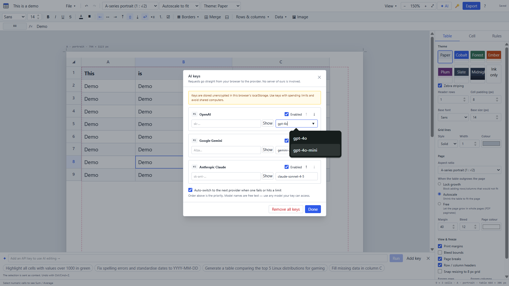

# Table Maker



A free, canvas-first table designer that runs entirely in the browser (GitHub Pages) or as a desktop app (Tauri).

Design a table on a page with a fixed aspect ratio, format it, validate it, drive it with formulas or AI, and export it to seven formats.

## Features (v1)

* **Canvas** - A-series (1 : √2) portrait/landscape, 16 : 9, 4 : 3, 1 : 1 or custom pages; zoom 10-500 % (Ctrl/Cmd + wheel), pan, fit to screen; margin / bleed / page-break guides and crop marks.
* **Page fit modes** - *Lock growth*, *Autoscale to fit*, or *Free (multi-page)*.
* **Grid** - virtualised rendering, multi-cell selection, inline editing, insert/delete/reorder rows & columns (drag headers), resize, merge/unmerge, freeze panes, sort, filters, zebra striping, 8 themes, per-edge borders (all/outer/inner/top/bottom/left/right, width/style/colour).
* **Content** - bold/italic/underline/strike, colours, fonts, alignment, bullet/numbered lists, checkboxes, images (drop / paste / insert; contain, cover, stretch, original, center; auto row height).
* **Data** - formulas (`SUM AVERAGE/AVG MIN MAX COUNT CONCAT IF ROUND` + more), data validation (number, select dropdown, date, email, URL, checkbox), conditional formatting (thresholds, colour scales, data bars), undo/redo, clipboard compatible with Excel/Sheets, draft autosave (IndexedDB).
* **Import** - CSV/TSV, XLSX, JSON, Markdown tables (drag & drop or File → Import). Templates included.
* **Export** - CSV, Excel, Markdown, HTML, JSON, PDF (vector, paginated) and PNG, batch download or one `.zip`.
* **AI editing** - bring your own OpenAI, Gemini or Anthropic key; priority order and automatic fallback; each AI change is one undoable step.

## Quick start

```bash
npm ci
npm run dev          # http://localhost:5173
npm test             # unit + component tests (vitest)
npm run test:e2e     # end-to-end tests in Firefox and WebKit (builds and previews dist/ first)
npm run build:web    # static site in dist/
npm run tauri dev    # desktop (needs Rust + Tauri prerequisites)
```

Deploy to GitHub Pages: push to `main` with Pages source set to **GitHub Actions** (see `docs/deployment.md`).

## Cross-browser testing

The end-to-end suite runs the production build (served with `vite preview` under the same
`/table-maker/` base path as GitHub Pages) in **Firefox** and **WebKit**, the engine behind Safari.
It checks behaviour rather than pixels: every network request and response status, console `error`
and `warning` output, uncaught page errors and unhandled promise rejections, and WebSocket events.
A reusable fixture (`tests/fixtures/diagnostics.ts`) attaches all listeners and runs the assertions
automatically, so every spec gets the checks for free.

```bash
npm run test:e2e                              # Firefox + WebKit
npx playwright test --project=firefox        # one engine
npx playwright show-trace test-results/<test>/trace.zip   # replay a failure
```

`cross-browser.yml` runs the same suite on every push to `main`, every pull request and on demand,
with one matrix job per engine on Linux runners. Traces (`on-first-retry` in CI) are uploaded only
when a test fails. Full details, including how to add a spec and how to debug a CI failure, are in
`docs/testing.md`.

## Project docs
`docs/architecture.md` · `docs/contracts.md` · `docs/deployment.md` · `docs/security.md` · `docs/testing.md`

## Known limitations (v1)
* Text formatting is **per cell**, not per character.
* Formula references are updated on insert/delete, but **not** when rows are sorted or moved.
* Vector PDF uses built-in Latin-1 fonts; documents with other scripts (Bengali, Arabic, CJK…) are exported as high-resolution raster pages automatically. On-screen/PNG text uses system fonts, so it renders any script your OS supports.
* XLSX export/import covers values, formulas, basic styles, merges and widths - not charts or images.
* Frozen panes are approximated with sticky positioning of the frozen cells.
* AI model names are free text because providers retire models; defaults can be changed in *AI keys*.
* The Tauri desktop shell is not covered by the automated tests; the web app is. The Playwright suite
  runs in Firefox and WebKit, which approximates Safari but is not Safari itself (see `docs/testing.md`).
* API keys live in localStorage (unencrypted) - see `docs/security.md`.

MIT licensed.
